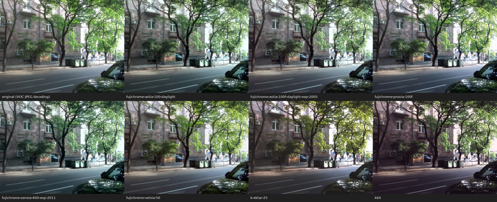

# HALD CLUT processing in Oberon

I was interested in HALD CLUT processing for a long time, and had Pascal implementations. Now since recently we have ported jpeg module from ETH Oberon system to VOC, and introduced PNG support, we are able to apply HALD colour lookup tables to a JPEG or PNG photograph.

The program uses integer trilinear interpolation and preserves the source image's alpha channel. It writes the result as PNG.

The same Oberon processing module builds for sequential execution or for multicore CPU execution through OpenMP, using VOC's experimental `ALL` statements and iteration-local `WITH` variables.

## Comparison



The original photograph is at the top left. The other panels show conversions using the LUT named below each image. All seven conversions matched my older FreePascal implementation pixel-for-pixel when given the same decoded source pixels. Sequential and OpenMP results were also identical.

## Building

Requirements:

- A VOC compiler supporting `ALL`, iteration-local `WITH`, `-j` and `-jP`.
- A VOC source checkout containing the PNG and JPEG codecs under
  `src/ports/polpo/` and the zlib modules under `src/ports/s3/`.
- GNU Make and GCC or Clang with its OpenMP runtime.
- Python 3 for the tests.

Clone this repository and select your VOC source tree, runtime and compiler:

```sh
git clone https://github.com/norayr/voc-hald-clut.git
cd voc-hald-clut

export VOC_SOURCE=/path/to/voc/compiler
export VOCROOT="$VOC_SOURCE/install"
export VOCLIBDIR="$VOCROOT/lib"
export VOC="$VOCROOT/bin/voc"

make
```

Adjust `VOCROOT`, `VOCLIBDIR` and `VOC` if your runtime libraries and compiler are in different locations. The build compiles the image codecs from `VOC_SOURCE`.

The default build produces both executables:

- `build/2/sequential/HaldCmd` — sequential processing, compiled with `-j`.
- `build/2/cpu/HaldCmd` — OpenMP CPU processing, compiled with `-jP`.

Use `make sequential` or `make cpu` to build one version. Use `make MODEL=C` to build model C; its executables go under `build/C/`.

On Linux, if your VOC runtime is outside the system library search path, set:

```sh
export LD_LIBRARY_PATH="$VOCLIBDIR${LD_LIBRARY_PATH:+:$LD_LIBRARY_PATH}"
```

## Running

Use a JPEG or PNG photograph and a HALD LUT PNG:

```sh
./build/2/sequential/HaldCmd photo.jpg film.png result.png
```

For CPU-parallel processing with four OpenMP threads:

```sh
OMP_NUM_THREADS=4 ./build/2/cpu/HaldCmd photo.jpg film.png result-parallel.png
```

When `OMP_NUM_THREADS` is unset, the OpenMP runtime chooses its default thread
count.

The command accepts an optional repetition count from 1 to 1000:

```text
HaldCmd input.jpg|png lut.png output.png|- [repetitions]
```

Each repetition processes the original input and prints its conversion time in milliseconds. Image loading, output allocation, an initial warm-up conversion, and image saving are outside the measured interval. Use `-` as the output name to skip saving an image, for example:

```sh
OMP_NUM_THREADS=4 OMP_DYNAMIC=FALSE \
  ./build/2/cpu/HaldCmd photo.jpg film.png - 7
```

## Testing

With the build variables above still set:

```sh
make test
```

The tests check identity, inverted and random LUTs at several cube sizes, including colour boundaries and alpha preservation. They compare sequential output and OpenMP output with one, two and four threads against an independent reference, and check that invalid cube sizes are rejected.
